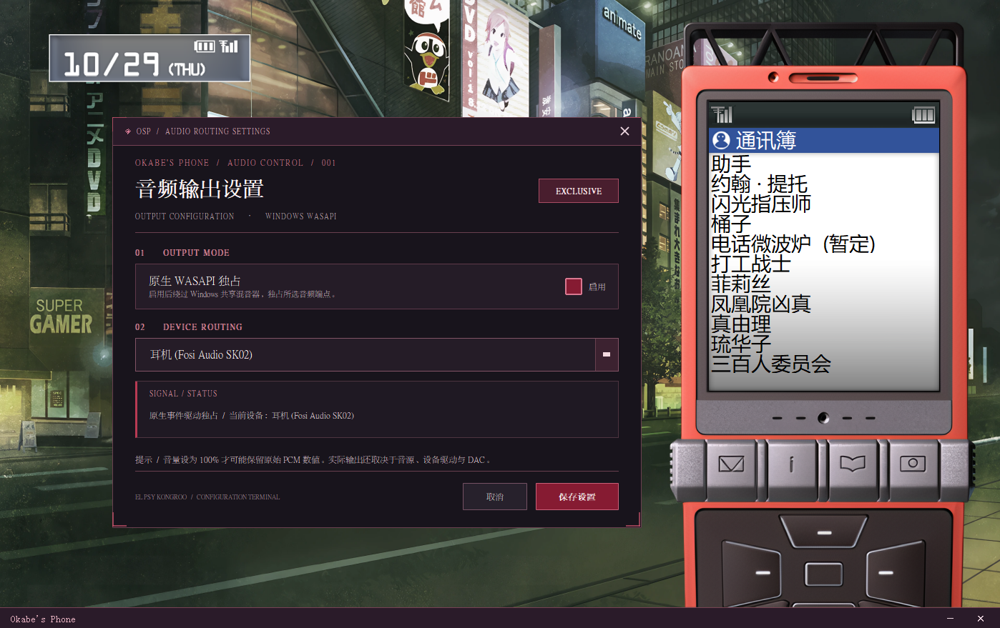
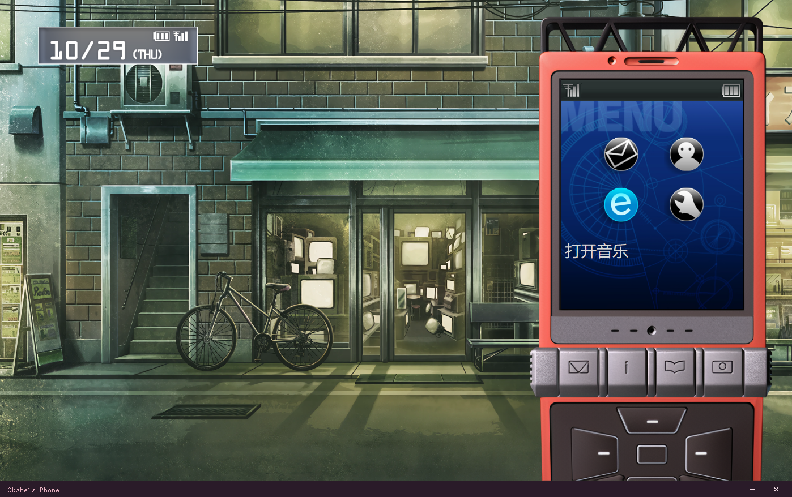
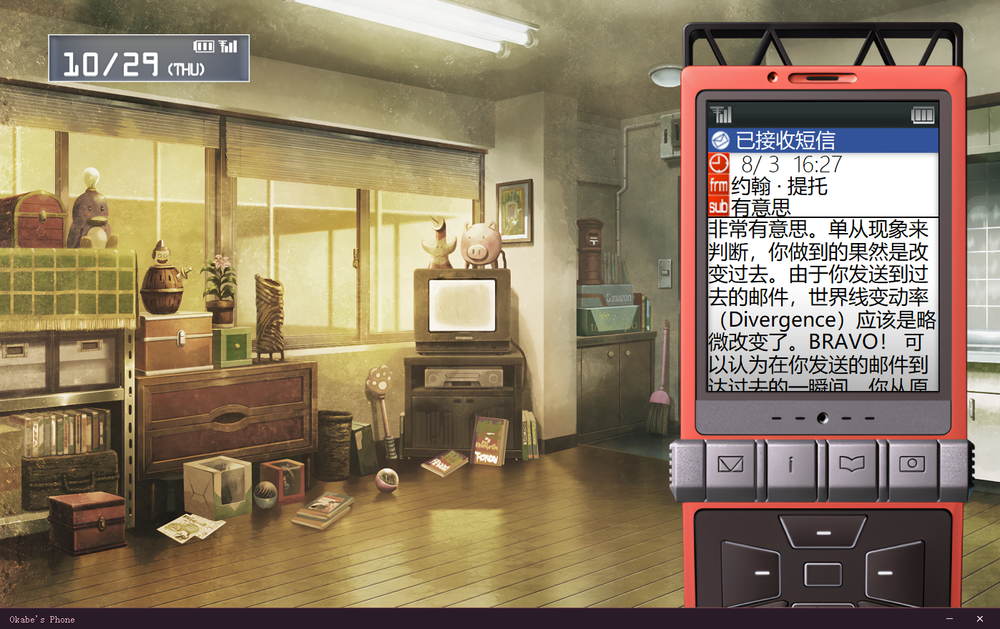
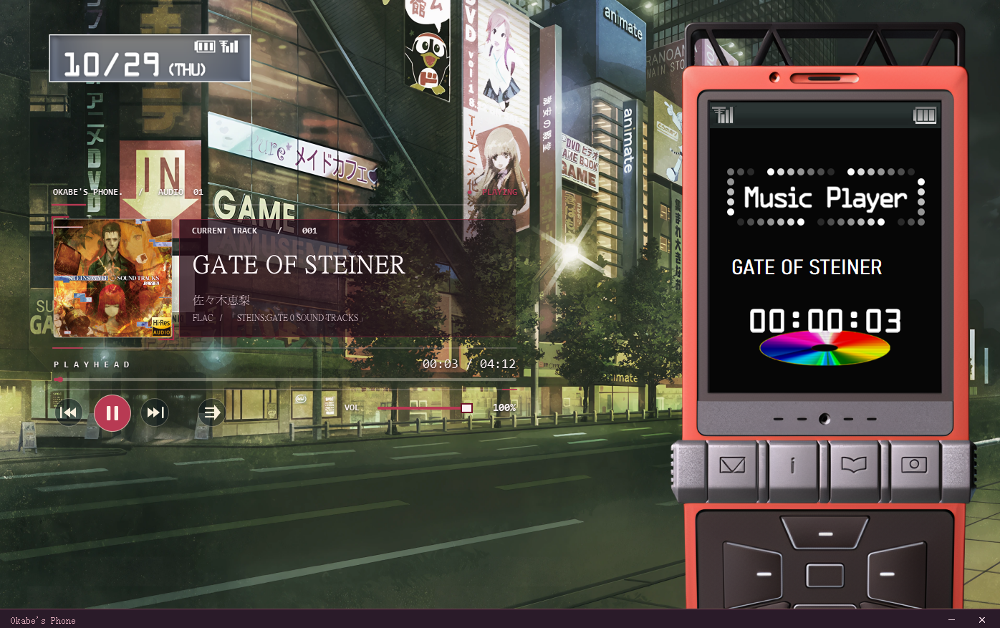

# Okabe's Phone

> 基于《命运石之门》本篇画面改造的 Windows 本地音乐播放器。  
> 在重现冈部伦太郎手机界面的基础上，加入了本地音乐播放、WASAPI 独占输出及个性化设置。

**本项目仅提供可执行版本的压缩包下载。**

### 📦 [下载最新版本（Releases）](https://github.com/ShikiMizuhara/Okabe-s-Phone/releases/download/v2.0.0/Okabe.s.Phone.rar)

---

## 最新版本 · 音频与视觉升级

本次更新主要围绕 **音频输出、视觉素材和播放控制界面** 展开，保留原版游戏的手机交互氛围，同时改善日常聆听体验。

> [!IMPORTANT]
> **使用 WASAPI 独占模式前，请先按 `Ctrl + P`！**
>
> 在程序中按 **`Ctrl + P`** 打开「音频输出设置」窗口 → 勾选 **「原生 WASAPI 独占」** → 选择音频设备 → 点击 **「保存设置」**。
>
> 独占模式**需要手动启用**。仅连接 USB DAC 或解码耳放，并不意味着已经开启独占。

### 01 / 原生 WASAPI 独占输出

- 新增 Windows 原生 **WASAPI 独占模式**。
- 支持选择兼容的输出设备，包括 USB DAC、解码耳放一体机等。
- 独占模式可绕过 Windows 共享音频混音流程。
- 实际可用的采样率、位深和 PCM 输出格式，以音源、设备及驱动的支持情况为准。

独占输出时，其他程序可能暂时无法通过同一设备发声。需要恢复共享输出时，可再次按 `Ctrl + P` 关闭独占模式。

### 02 / 图片与图标清晰度全面提升

- 对游戏画面、壁纸及界面图标进行了清晰度升级。
- 尽可能保留《命运石之门》本篇的原有视觉风格。
- 改善高分辨率显示环境下的画面观感。

### 03 / 全新音乐播放控制界面

- 左侧音乐控制区域重新设计，采用深红色风格。
- 加入专辑封面显示及无封面时的默认占位画面。
- 重新调整歌曲名称、歌手、专辑及音频格式信息。
- 优化播放按钮、进度条和音量控件，并改善明亮壁纸下的文字可读性。
- 为满足 **24-bit / 96 kHz 及以上无损整数 PCM 文件规格**的音乐提供 Hi-Res 角标提示。
- `Ctrl + P` 音频设置窗口同步采用深红色主题。

*Hi-Res 角标基于音频文件的参数判断，不代表对真实母带规格或认证资质的验证。*

---

## 界面预览

### 原版风格的手机主菜单

游戏中的手机布局与交互得到保留，并对画面素材进行了清晰度优化。

### 短信与游戏内容

信箱中收录了 Chapter 10 冈部伦太郎手机中的短信内容（可能不完整），暂未包含附件。

### 更多界面展示

---

## 主要功能

### 手机模拟交互

- 点击左上角日期按钮，可唤出冈部伦太郎的手机主菜单。
- 鼠标左键单击充当“前进”或“确认”。
- 鼠标右键单击充当“返回”。
- 主界面左下角的浏览器图标现作为音乐播放器入口。

### 本地音乐播放

双击音乐列表中的歌曲即可播放，左侧控制区提供：

- 上一曲、播放 / 暂停、下一曲
- 顺序播放 / 单曲循环
- 音量调节及可点击跳转的进度条
- 歌曲封面、歌名、歌手、专辑与音频格式显示

### 自定义设置

- 指定本地音乐文件夹路径。
- 选用内置游戏壁纸，或设置自定义壁纸。
- 推荐壁纸尺寸：**1400 × 850**，以获得更合适的显示比例。

### 音频设备设置

通过 **`Ctrl + P`** 打开专用音频设置窗口，可以启用或关闭 WASAPI 独占，并选择兼容的输出设备。

---

## 使用方法

1. 在右侧 **Releases** 页面下载最新压缩包，或点击页面顶部的下载链接。
2. 解压后运行程序。
3. 点击左上角日期按钮，进入手机菜单。
4. 进入「进行各种设定」，指定本地音乐文件夹。
5. 返回主界面，点击左下角浏览器图标。
6. 在音乐列表中双击歌曲开始播放。
7. 如需使用解码耳放进行 WASAPI 独占播放，**按 `Ctrl + P` → 启用独占 → 选择设备 → 保存设置**。

> **注意：** 返回主界面时，音乐播放会自动暂停并关闭。

---

## 注意事项

- **WASAPI 独占适用于 Windows 及兼容的音频设备。** 不同设备或驱动可能支持不同的输出格式。
- 开启独占模式时，其他程序可能暂时无法使用同一音频设备。
- 音乐列表目前不支持分类、折叠或排序，仅按读取顺序排列；音乐数量极多时的表现尚未充分验证。
- 歌曲名称优先读取音频元数据，读取失败或检测到乱码时回退至文件名，但仍可能遇到编码异常。
- 自定义壁纸推荐使用 **1400 × 850** 比例，否则可能出现比例失调。
- 软件主要面向本地音乐播放与游戏界面欣赏。

---

## 结语

本项目无任何商业用途。

**El Psy Kongroo.**
